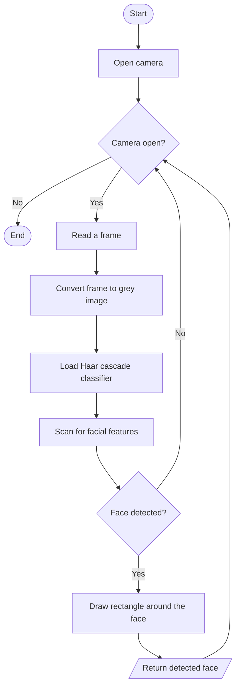

# Project Report Summary: Face Recognition using ESP-32 CAM

Diploma capstone project, Electronics & Telecommunication Engineering, Government Polytechnic Solapur, academic year 2025-26 (Capstone Project course 316004). Guide: Prof. P. R. Doke.

## Abstract

A face recognition system built around the **ESP32-CAM** module, which combines an ESP32 microcontroller, a camera and Wi-Fi. The work covers capturing and pre-processing facial images, detecting faces, matching them against saved faces and showing the result live. The system is meant as a low-cost, portable base for security, surveillance, access control and **attendance** (marking a person present with the time). Suggested further work: performance optimisation, multi-factor authentication, real-time tracking and IoT / cloud integration.

## 1. Introduction

**Problem statement.** Traditional security and attendance systems are not fully reliable because of duplication, manual errors and lack of automation. A smart system is needed that identifies individuals automatically and keeps records without human intervention.

**Objectives**
- Develop a real-time face recognition system using ESP32-CAM
- Detect and recognise human faces accurately
- Implement login / logout functionality
- Enhance security using biometric authentication
- Create a low-cost and efficient solution

**Applications.** Smart-home security, office and college attendance, access control, surveillance.

## 2. Block diagram

OV2640 camera (image capture) -> ESP32-CAM (image processing, face detection, draw face box) -> built-in Wi-Fi -> wireless network -> PC / laptop browser (live video stream and face box display). A USB-to-TTL module is used for programming and power.

ESP32-CAM pin groups described in the report: power (5 V, 3.3 V, GND); GPIO pins (12, 13, 14, 15, 2, 4, 16, 0, 1, 3); camera interface (HS2_DATA0-3, HS2_CLK, HS2_CMD); UART (U0TXD GPIO1, U0RXD GPIO3); control pins (GPIO0 LOW = upload mode, HIGH = normal run).

## 3. Literature survey

| Method | Advantages | Limitations |
| --- | --- | --- |
| Password / RFID | Simple and low cost | Less secure, can be duplicated |
| Fingerprint recognition | Accurate | Requires physical contact |
| Haar cascade | Fast and lightweight | Less accurate in complex conditions |
| Deep learning | High accuracy | High computational requirement |
| ESP32-CAM system | Low cost, portable, IoT enabled | Limited processing power |

**Research gap.** High-accuracy systems need powerful hardware, and low-cost systems lack accuracy and efficiency, so a system that balances cost, accuracy and performance is needed.

**Problem definition.** Develop a low-cost, real-time face recognition system using ESP32-CAM that can accurately detect and recognise individuals, overcoming the limits of traditional security systems while performing efficiently on limited hardware.

## 4. Scope (future work listed in the report)

Real-time face tracking, emotion recognition, privacy enhancements (anonymisation, secure storage), integration with IoT and cloud services, and application-specific customisation such as attendance management and access control.

## 5. Methodology

The system captures images, processes them, detects faces and performs recognition for authentication (login / logout). Main parts: ESP32-CAM module (camera + controller), Wi-Fi network, face recognition algorithm, and a web interface / serial monitor output.

**Algorithms described:** Haar Cascade for face detection (pattern recognition, fast, suited to real-time use) and a face recognition step that matches a captured face against stored data.

## 6. Implementation

**Hardware:** ESP32-CAM is powered and programmed with the Arduino IDE; an FTDI programmer uploads the code; the camera captures images.

**Software:** Arduino IDE (firmware), Visual Studio (development environment and dependencies), OpenCV and Python (background and tooling), HTML / CSS / JavaScript with face-api.js (dashboard).

**Steps in the report**
1. Install the ESP32CAM library in the Arduino library folder.
2. Flash the ESP32-CAM firmware (camera config, Wi-Fi connect, camera server). See [`esp32/esp32_cam_stream/esp32_cam_stream.ino`](../esp32/esp32_cam_stream/esp32_cam_stream.ino).
3. Install Visual Studio (Desktop development) for the dependencies.
4. Run the FaceRecog dashboard. See [`web/dashboard.html`](../web/dashboard.html).

**Dashboard logic:** SSD MobileNet v1 face detection (minimum confidence 0.6), 68-point landmarks, face descriptors, a FaceMatcher with a 0.6 threshold, new faces saved by name in the browser's localStorage, known faces drawn with a green box and unknown with a red box, detection every 80 ms.

## 7. Components and specifications

| Component | Specification |
| --- | --- |
| ESP32-CAM development board | AI Thinker module, dual-core 32-bit CPU (up to 240 MHz), 520 KB SRAM |
| Camera module | OV2640 2-megapixel sensor, supports JPEG, BMP and grayscale |
| External memory | PSRAM, used for processing facial feature vectors |
| Communication | Wi-Fi 802.11 b/g/n, Bluetooth 4.2 / BLE |
| Power supply | 5 V DC, at least 2 A recommended to avoid brown-outs during recognition |
| Programming interface | FTDI USB-to-serial adapter (or ESP32-CAM-MB micro-USB shield) |
| Storage | MicroSD card slot (up to 4 GB) for logging image data |

## 8. Face detection vs face recognition

| Parameter | Face detection | Face recognition |
| --- | --- | --- |
| Definition | Identifies and locates faces in an image or video | Identifies or verifies whose face it is |
| Purpose | To find faces | To match faces with stored data |
| Output | Location (bounding box) of faces | Identity (name or ID) of the person |
| Process type | Basic / initial step | Advanced step (after detection) |
| Technology | Haar Cascade, CNN | Deep learning, neural networks |

## 9. Results and applications

The dashboard draws a box and the registered name around a recognised face in the live view (report Fig. 8). Applications: smart-home security, office and college attendance, access control, surveillance.
